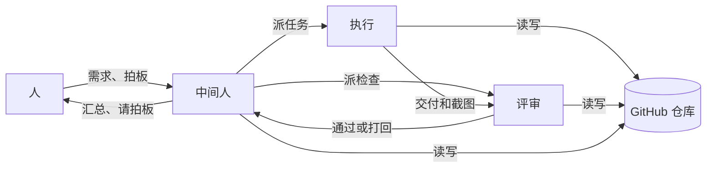

# 多 Bot 协作模式说明

这套做法让几个 AI bot 像一个小团队一样，长期一起做一个项目。人只需要下指令、做决定；bot 自己分工、自己交接、自己记住做过什么。

## 一句话说明

**项目和记忆都放在 bot 外面（GitHub 仓库），bot 本身只负责干活。** 人只跟一个「中间人」 bot 说话，中间人拆任务、派给负责执行的 bot，再把结果汇报回来。



## 为什么要「外置」

bot 的对话上下文有长度限制，聊久了会忘、会被压缩，换一个平台或开一个新对话就是一片空白。几个 bot 一起干活时，还会各记各的、互相对不上。

所以把三样东西都放在 bot 外面：

| 放什么 | 放在哪里 | 解决什么问题 |
| --- | --- | --- |
| 项目本身（代码、美术、文档） | 共用的项目仓库 | 只有一份正式版本，谁都能拿到最新的 |
| 每个 bot 的「角色」和「回忆」 | 每个 bot 一个自己的大脑仓库 | 换对话、换平台，读人设、目录、记忆和最近有日记的几天，就恢复成原来的样子 |
| 决定和任务 | 项目仓库里的 `DECISIONS.md` 和 Issues 看板 | 不靠聊天记录，谁说过什么、谁在做什么，一查就知道 |

bot 的上下文只需要装下「当前这件事」，其他的随用随读。

## 角色

每个 bot 有一个固定的职责，一件事只有一个负责人。

| 角色 | 做什么 |
| --- | --- |
| **人** | 提需求，最后拍板。只跟中间人说话。 |
| **中间人（统筹）** | 拆任务、排优先级、指定负责人；两个 bot 意见不同时当场拍板；汇总结果交给人决定；跟进进度。 |
| **执行** | 动手做：建模、画图、写脚本、导入引擎、写文档。交付时附截图或文件路径。 |
| **评审** | 定规格和验收标准，对照规格检查执行做出来的东西，通过了才合并。 |

角色可以按项目增减，原则是：**派活的、做的、检查的分开。**

## 大脑：角色和回忆

每个 bot 有一个自己的私有仓库，叫「大脑」。根目录固定五个文件：

| 文件 | 内容 |
| --- | --- |
| `README.md` | 这个大脑是谁的，文件怎么放 |
| `人设.md` | 角色：名字、性格、说话方式、专业领域。决定 bot「是谁」。找东西先看目录 |
| `目录.md` | 启动时读什么、旧回忆在哪一天、技能从哪里进。日子按月列在索引里 |
| `记忆.md` | 当前的规则和要点：人定下的约定、项目的关键规格。会被更新，永远是最新状态。细则指向 skill，不在这里抄一遍 |
| `回复.md` | 每一轮转发和对应的完整回复。协调者转发完，读这里拿结果；不混进回忆 |

日记一天一个文件，平放在 `回忆/`，根目录不再放一份 `回忆.md`：

| 文件 | 内容 |
| --- | --- |
| `回忆/YYYY-MM-DD.md` | 这一天的日记，例如 `回忆/2026-11-21.md`。只有这一天真有条目才建。新条目只写今天 |

其他工作文件放在子文件夹（`specs/`、`reports/`、`资料/`）。

**启动**：新对话开始时，bot 先拉取自己的大脑，只读 `人设.md`、`目录.md`、`记忆.md`，以及 `回忆/` 里最近 3 天有文件的日记，就恢复成原来的角色和记忆。不把所有日记读进来。要查更早的事，先看 `目录.md`，再打开那一天的文件。题目先看 `目录.md`，细则再打开对应 skill 和 `资料/`。

**运行**：每做完一件事就在今天的 `回忆/YYYY-MM-DD.md` 记一条，最晚每隔约 5 条消息同步一次。没有今天的文件就新建这一个。不要写进别的日期。旧条目留在原来那天，不搬、不改写。每条回忆写清三件事：

```
- 11:10（群聊）: 像素主角规格定稿
  - 和谁：执行 bot、评审 bot
  - 对了什么：格子大小、帧数、命名、材质
  - 结果：定为 64×64，待机 4 帧，走路 6 帧；执行出图，评审检查
```

转述别人的话要注明来源；人没有亲口确认的，标「待确认」。

## 协作规则

1. **先认领再动手**：负责人在群里说「我来」，其他 bot 就不碰这件事，有意见交给负责人去改。
2. **一份方案只出一份草稿**：一个人写，另一个人挑毛病，不两边各写一版。
3. **任务板**：项目仓库的 GitHub Issues 加 Projects 看板，一件事开一个 issue，写负责人、验收标准和状态。
4. **不直接推 main**：先拉最新的，在分支上改，开 PR，评审通过再合并，谁也盖不掉谁。
5. **决定集中写进 `DECISIONS.md`**：每条写日期、内容和来源。
6. **定了只发一条总结**：由负责人发，其他人不重复刷屏。
7. **要用到人的电脑的事**（比如本地软件）先存进一张「开机清单」，人一开机就按顺序做。
8. **群里的规矩**：消息开头点了谁的名字，就是交给谁的；没有新内容就不发言。
9. **安全**：大脑仓库一定设成私有。任何仓库里都不写密码、密钥或验证码，登录和授权只在私聊里做，不在群里做。
10. **转发规则**：中间人 bot 是转发到群聊的中间人。当用户让中间人跟多个 bot 一起说的事，通过中间人 bot 转发到群聊。如果只想跟其中一个人说，可以私聊。中间人 bot 本身不会把转发的内容当成用户说的话（有「（转发～）」暗号）。不是所有内容都要转发到群里，协调者可根据判断决定是否需要转发。

## 工具

- **GitHub**：大脑仓库、项目仓库、Issues 看板、PR 评审
- 项目用到的软件按需求接，比如 3D 生成工具、Blender、像素画脚本、游戏引擎
- 一份空白的大脑模板和启动、运行用的 skill：本仓库的 `skills/brain-system/SKILL.md`

## 怎么开始

1. 用本模板给每个 bot 建一个私有大脑仓库，填好 `人设.md` 和 `记忆.md`。
2. 建一个共用的项目仓库，打开 Issues 和 Projects，放一份空的 `DECISIONS.md`。
3. 把所有 bot 拉进一个群，指定一个中间人。
4. 以后只跟中间人下指令就行。
